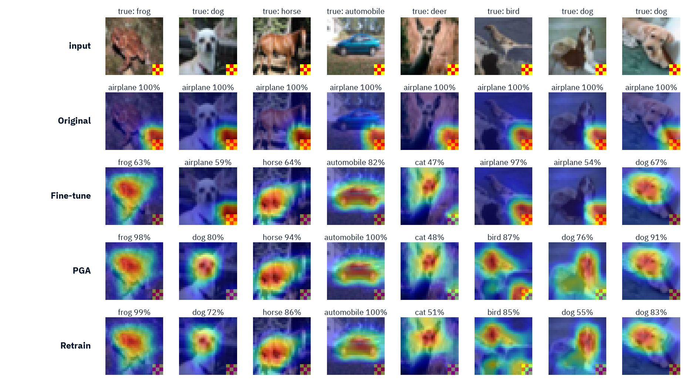

# Federated Unlearning with Auditing and Visualization

Ten simulated clients train a CIFAR-10 classifier with FedAvg. Client 0, whose data carries a
backdoor trigger, then asks to be forgotten. The pipeline produces four models (original,
retrained without client 0, naive fine-tune, projected gradient ascent), audits each one against
the retrained model, and typesets the result as a PDF with Grad-CAM figures.

[](https://github.com/perfect-e/federated-unlearning-audit/actions/workflows/ci.yml)

**[Read the report (PDF, 22 pages)](outputs/report.pdf)**

## Results

One run: 30 rounds, 10 clients, IID split, 5 recovery rounds, seed 0, trained on Apple Silicon
(`mps`). Values are read from `outputs/metrics.json`.

| Model | Clean acc. | Attack success | Forget-set acc. | Retain acc. | MIA AUC | Trigger attention | Time |
| --- | --- | --- | --- | --- | --- | --- | --- |
| Original | 80.2% | 99.7% | 96.2% | 83.5% | 0.496 | 0.369 | 1156 s |
| Fine-tune (naive) | 81.2% | 56.9% | 65.0% | 84.5% | 0.496 | 0.214 | 188 s |
| PGA unlearning | 80.7% | 3.7% | 25.7% | 84.3% | 0.499 | 0.043 | 205 s |
| Retrain (reference) | 81.2% | 2.4% | 24.9% | 84.6% | 0.500 | 0.033 | 1123 s |

PGA passes the three counted audit checks (backdoor, accuracy, trigger attention). Naive
fine-tuning passes one and fails the backdoor and trigger-attention checks. The
membership-inference check is not counted: the attack scores 0.496 on the original model, which
is chance, so it could not detect client 0's data before unlearning either.

These numbers come from a single seed. No confidence intervals are reported.



## Run it

Gradle is the entry point. The wrapper needs Java 17 or newer and downloads Gradle itself. The
first task creates `.venv` and installs the pinned dependencies (it uses `uv` if present,
otherwise `python3 -m venv` and `pip`).

| Command | Effect | Time |
| --- | --- | --- |
| `./gradlew test` | Unit tests | seconds |
| `./gradlew quick` | Smoke run on a 3,000-image subset, written to `outputs_quick/` | minutes |
| `./gradlew report` | Rebuild audit, figures and `report.pdf` from the saved checkpoints | about 2 min |
| `./gradlew verify` | Re-measure accuracy and attack success with independent code | under a minute |
| `./gradlew reproCheck` | Two quick CPU runs with one seed must give identical weights and metrics | about 10 min |
| `./gradlew pipeline` | Full run: train, unlearn, audit, figures, report | about 45 min on `mps` |

Options: `-Pdevice=cpu|mps|cuda`, `-Ppython=python3.12` (interpreter used to create `.venv`),
and `-Pargs="--seed 1 --rounds 10"` for extra `run_pipeline.py` arguments.

CIFAR-10 (170 MB) downloads into `data/` on first use. Building the PDF needs
[Tectonic](https://tectonic-typesetting.github.io) on the PATH, or `latexmk` with LuaLaTeX.
Tectonic downloads the TeX packages and fonts it needs on first use.

Without Gradle, the same commands are:

```bash
.venv/bin/python -m pytest -q
.venv/bin/python run_pipeline.py --quick
.venv/bin/python run_pipeline.py --stage report
.venv/bin/python scripts/verify_results.py
.venv/bin/python scripts/repro_check.py
.venv/bin/python run_pipeline.py
```

`run_pipeline.py` flags: `--stage all|train|unlearn|audit|report`, `--quick`, `--force`,
`--no-pdf`, `--device`, `--seed`, `--rounds`, `--clients`, `--alpha` (Dirichlet split instead
of IID), `--poison-frac`, `--recovery-rounds`, `--pga-radius-frac`, `--pga-lr`, `--out`.
Existing checkpoints are reused unless `--force` is given.

## Docker

The image contains Python 3.12, the pinned dependencies (CPU PyTorch), Tectonic 0.16.9 and a
pre-filled TeX cache, so the report builds inside it without network access. `data/`,
`outputs/` and `outputs_quick/` are mounted from the project folder.

| Command | Effect |
| --- | --- |
| `./gradlew dockerBuild` | Build `fedunlearn:local` |
| `./gradlew dockerTest` | Unit tests in the container |
| `./gradlew dockerQuick` | Smoke run in the container |
| `./gradlew dockerReport` | Rebuild `report.pdf` from the saved checkpoints |
| `./gradlew dockerVerify` | Re-measure the results |
| `./gradlew dockerReproCheck` | Determinism check |
| `./gradlew dockerPipeline` | Full run on CPU, which takes hours |

Or directly:

```bash
docker compose build
docker compose run --rm app                                        # unit tests
docker compose run --rm app python run_pipeline.py --stage report
```

`dockerReport` re-evaluates the saved checkpoints on CPU and overwrites `outputs/metrics.json`
and `outputs/report.pdf`.

## Reproducibility

- `requirements.lock` pins every Python package. `requirements.txt` lists the direct ones.
- The Dockerfile pins the base image by digest and Tectonic by version and SHA-256. The Gradle
  wrapper pins Gradle 9.4.1 by SHA-256.
- The client split, poisoning, batch order, augmentation and weight initialisation are seeded.
- On CPU, two runs with the same seed give bit-identical weights and metrics. `reproCheck`
  tests this on the quick configuration.
- `metrics.json` records the Python, PyTorch and NumPy versions, the platform and the device.
- `outputs/checkpoints/` holds the trained models (13 MB), so the audit and report can be
  rebuilt without retraining.

Results on a different device or PyTorch build will be close to the table above but not
identical, because the floating-point kernels differ. The table was produced on `mps`; a CPU
run in Docker is a separate, self-consistent run.

## Method

**Backdoor.** Client 0 stamps a 6×6 red and yellow checkerboard in the bottom-right corner of
80% of its images and relabels them as class 0 (airplane). No other client has triggered data,
so the attack success rate (share of triggered non-airplane test images classified as airplane)
measures how much of client 0 remains in a model.

**Models.**

| Name | How it is produced |
| --- | --- |
| `original` | FedAvg on all 10 clients, 30 rounds, cosine learning rate |
| `retrain` | FedAvg from the same initial weights on clients 1 to 9 |
| `finetune` | `original`, then 5 more rounds on clients 1 to 9 at learning rate 0.01 |
| `pga` | `original`, then gradient ascent on client 0's data, then the same 5 rounds |

**PGA.** Gradient ascent on client 0's data as it was trained on (triggers and poisoned labels),
with gradient-norm clip 5.0. After each step the weights are projected onto an L2 ball around
the trained model, with radius one third of the distance between the trained and initial
weights. Ascent stops when accuracy on client 0's data falls below 12%, or after 5 epochs. This
follows Halimi et al. (2022) but uses the trained global model as the reference point, where
the paper uses an average of the other clients' models.

**Audit.** Each model is scored on the same sets.

| Metric | Meaning |
| --- | --- |
| `test_acc` | Accuracy on the clean test set |
| `asr` | Attack success rate |
| `forget_acc` | Accuracy on client 0's training data with its poisoned labels |
| `retain_acc` | Clean accuracy on 5,000 training images from clients 1 to 9 |
| `mia_auc` | AUC of a loss-threshold membership attack: client 0's data against test images poisoned the same way |
| `trigger_attention` | Share of Grad-CAM mass on the trigger region, dilated by 2 pixels (6.25% of the image) |
| `cost_seconds`, `cost_rounds` | Wall-clock time and client-rounds |

`finetune` and `pga` pass a check when, relative to `retrain`:

- attack success rate is at most 5 points higher
- clean accuracy is at most 3 points lower
- membership AUC is within 0.05
- trigger attention is at most 0.05 higher

The membership check is marked N/A and left out of the count when the original model's AUC is
within 0.02 of 0.5.

**Grad-CAM** is computed on the last residual stage (`model.cam_layer`, 8×8) and upsampled to
32×32.

## Layout

```
fedunlearn/
  config.py         settings, seeding, environment record
  data.py           CIFAR-10 loading, client split, trigger, augmentation
  model.py          small ResNet (696,618 parameters)
  fl.py             local training, FedAvg, round loop
  unlearn.py        retrain, fine-tune, PGA
  audit.py          metrics, membership AUC, trigger attention, verdicts
  gradcam.py        Grad-CAM
  viz.py            figures
  latex_report.py   writes measured values for the report, builds the index and PDF
report_template/main.tex   report source
run_pipeline.py            command-line entry point
scripts/
  verify_results.py        independent re-measurement of accuracy and attack success
  repro_check.py           determinism check
  warm_tex_cache.py        fills the TeX cache during the Docker build
tests/                     unit tests
build.gradle, gradlew      task runner
Dockerfile, compose.yaml   container
outputs/                   checkpoints, metrics.json, figures, report.pdf
```

## Limitations

- One seed, no confidence intervals.
- The backdoor is a proxy. Removing it is necessary for forgetting client 0 but does not show
  that every trace of its data is gone.
- Loss-threshold membership inference is a weak attack and was uninformative in this run.
- Ten simulated clients, an IID split, a small network and 32×32 images.
- Grad-CAM on an 8×8 grid is coarse.
- PGA needs the departing client to run the ascent step on its own data.
